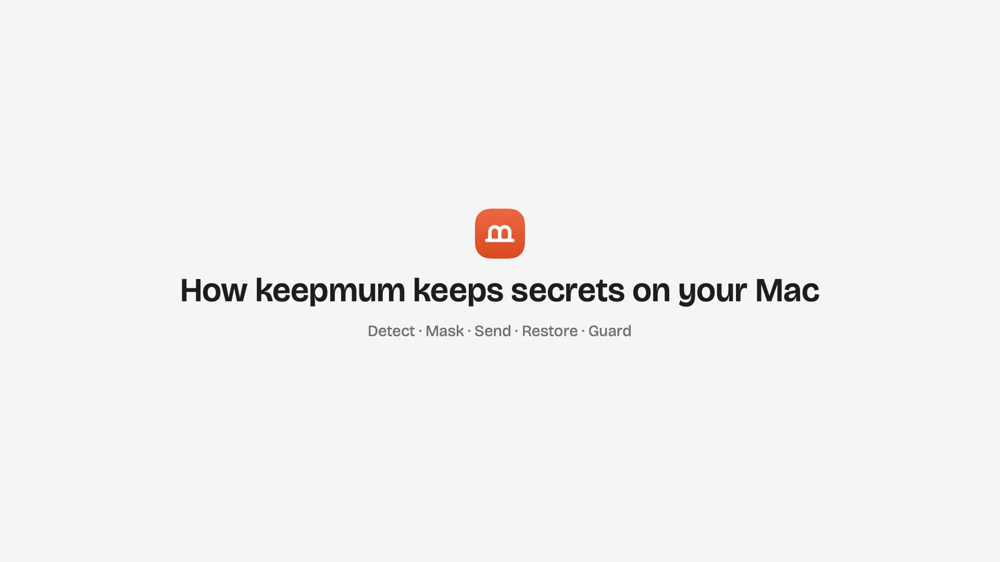
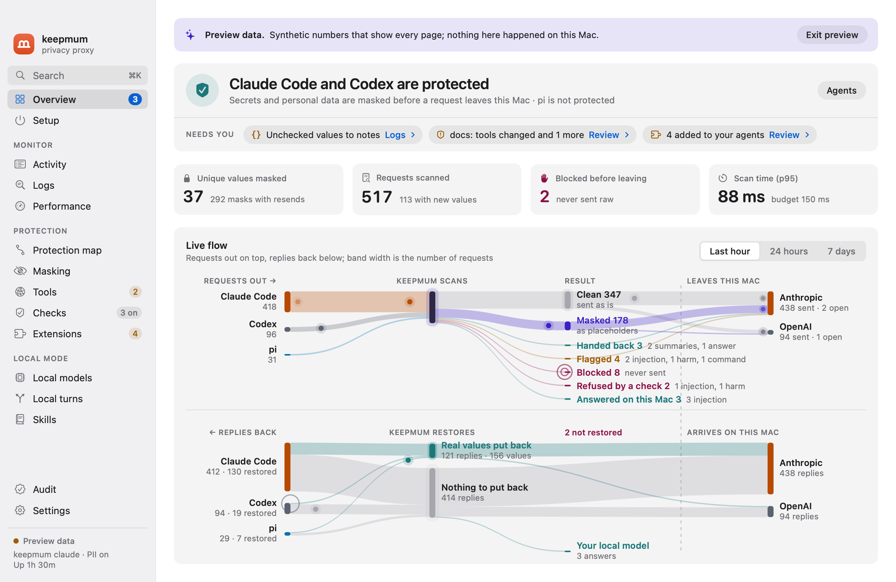

<p align="center"></p>

<h1 align="center">keepmum</h1>

<p align="center"><b>Keep secrets and personal data on your Mac while you use Claude Code, Codex, the Antigravity CLI, Gemini CLI, pi or opencode.</b></p>

<p align="center">
  <a href="https://github.com/blueandhack/keepmum/releases"></a>
  <a href="https://github.com/blueandhack/keepmum/releases"></a>
  <a href="https://github.com/blueandhack/keepmum/actions/workflows/ci.yml"></a>
  <a href="https://github.com/blueandhack/keepmum/actions/workflows/mac-app.yml"></a>
  <a href="LICENSE"></a>
  <br>
  
  
  
  <a href="https://keepmum.app"></a>
</p>

<p align="center">
  <a href="https://keepmum.app">Website</a> ·
  <a href="https://github.com/blueandhack/keepmum/releases">Download</a> ·
  <a href="https://keepmum.app/docs/">Docs</a> ·
  <a href="#install">Install</a> ·
  <a href="#use">Use</a> ·
  <a href="#limitations">Limitations</a> ·
  <a href="SECURITY.md">Security</a>
</p>

keepmum is a local proxy that sits between your coding agent (Claude Code, Codex, the Antigravity CLI, Gemini CLI, pi or opencode) and its model provider (Anthropic, OpenAI or Google). Before a request leaves your Mac, it finds secrets (API keys, tokens, passwords, private keys, connection strings) and, if you want, personal data (names, emails, phones, addresses, account numbers), and replaces each one with a placeholder such as `KEEPMUM_SECRET_7f3a9c2e`. When the model answers, keepmum puts the real values back, so your agent can still edit your `.env` file correctly, but the provider never sees what is in it.

Detection runs entirely on your Mac. Nothing is sent anywhere except the scanned request to the provider. The name comes from "keep mum": to say nothing about a secret.

> **Status: alpha.** The latest release is [0.1.0 alpha 14](https://github.com/blueandhack/keepmum/releases/tag/v0.1.0a14) (Nov 22, 2026); the first, 0.1.0 alpha 1, came out on Nov 3. keepmum works end to end, but it has not been audited, and things will change. Treat it as a safety layer, not a guarantee. See [Limitations](#limitations).

[](https://keepmum.app/#video)

▶ [See it on keepmum.app](https://keepmum.app/#video), drawn in the page, or [as a 110-second video](https://keepmum.app/video/keepmum-flow-8a1e7e88eb.mp4) of how a request travels through keepmum.

▶ [Take the 58-second tour of the app](https://keepmum.app/#tour): the menu bar, the live Overview, Logs, the Protection map and a turn under review, rendered from the app's own views on preview data, or [as a video](https://keepmum.app/video/keepmum-tour-3e6f04061d.mp4).



## How it works

```
Claude Code ─┐                            ┌──▶ Anthropic API
Codex       ─┤                            │
Antigravity ─┤                            │
Gemini CLI  ─┼─▶ keepmum (on your Mac) ───┼──▶ OpenAI API
pi          ─┤   detect → mask            │
opencode    ─┘                            └──▶ Google (Gemini API, Code Assist)
  real values  ◀── restore ◀───────────────── placeholders only
```

1. **Detect.** 96 rules with entropy and checksum checks, then [OpenAI Privacy Filter](https://huggingface.co/openai/privacy-filter) on the Mac's GPU, then a deterministic step that drops UUIDs, hashes and documented example keys. Hex dumps and base64 of a secret are decoded and scanned too.
2. **Mask.** Each value becomes a placeholder derived from a per-install key (HMAC-SHA256), the same one every time, so the provider's prompt cache keeps working. Values live only in memory.
3. **Restore.** Placeholders in the model's answers are swapped back on your Mac, in the syntax around them (quoted for the shell, escaped in JSON). Tools that reach the network get less: web search and fetch keep placeholders, an MCP server gets back only the values it returned, and none of them ever gets a secret.
4. **Fail closed.** A request keepmum cannot scan is blocked, never sent raw.

More in [How it works](https://keepmum.app/docs/about/how-it-works/).

## Install

A Mac with Apple silicon and macOS 14 or later, and Claude Code, Codex, the Antigravity CLI (`agy`), Gemini CLI, pi or opencode.

**The Mac app (everything included).** Download `Keepmum-<version>.dmg` from the [Releases](https://github.com/blueandhack/keepmum/releases) page, drag Keepmum into Applications, open it, and follow **Setup**: download the model, start the background service, and switch on protection for each coding agent you use.

**The command line** needs Python 3.12+, [uv](https://docs.astral.sh/uv/), and Xcode or its command line tools:

```sh
git clone https://github.com/blueandhack/keepmum.git && cd keepmum
uv tool install --editable .                  # installs `keepmum` and `keepmum-claude-wrapper`
native/pf-serve/build.sh                      # builds pf-serve from pinned sources into ~/.local/share/keepmum/bin
keepmum setup                                 # downloads the model (1.6 GB, once), checked against its pinned SHA-256
keepmum doctor                                # every line should be ✓ (the app: Settings › Check this Mac)
keepmum selftest                              # sends a canary secret through keepmum to a local mock; fails if it leaks
```

Disk, memory and every requirement: [Install](https://keepmum.app/docs/start/install/).

## Use

```sh
keepmum claude          # starts Claude Code with every request scanned; arguments pass through to `claude`
keepmum codex           # the same for Codex (ChatGPT login or API key)
keepmum agy             # the same for the Antigravity CLI
keepmum gemini          # the same for Gemini CLI

keepmum serve           # or run it in the background, at http://127.0.0.1:7788,
keepmum protect on      # and send every Claude Code, Codex, pi and opencode session to it
```

## Docs

The full documentation is at **[keepmum.app/docs](https://keepmum.app/docs/)**.

| | |
| --- | --- |
| [Use with your agents](https://keepmum.app/docs/start/agents/) | Each agent, VS Code, [the background proxy](https://keepmum.app/docs/start/background/), [in front of another gateway](https://keepmum.app/docs/start/gateways/) |
| [Choose what gets masked](https://keepmum.app/docs/masking/what-gets-masked/) | Personal data, your own rules and exceptions, [rules only](https://keepmum.app/docs/masking/rules-only/), [observe only](https://keepmum.app/docs/masking/observe/), [leaving a project out](https://keepmum.app/docs/masking/exclude/) |
| [Tools that reach the network](https://keepmum.app/docs/masking/network-tools/) | What MCP servers, web search and web fetch receive |
| [Optional checks](https://keepmum.app/docs/checks/) | Prompt injection, harmful requests and risky shell commands: warn, block, or [answer on your Mac](https://keepmum.app/docs/checks/local/) and [hand back to the cloud](https://keepmum.app/docs/checks/handback/) after [your review](https://keepmum.app/docs/checks/review/) |
| [Extensions](https://keepmum.app/docs/watch/extensions/) and [the audit log](https://keepmum.app/docs/watch/audit/) | What other apps add to your agents, and a tamper-evident record of what keepmum did |
| [Configuration](https://keepmum.app/docs/reference/configuration/) | Every key in `~/.config/keepmum/config.toml` |
| [What keepmum stores, and where](https://keepmum.app/docs/reference/storage/) | Every file, what stays in memory only, and the only network calls |
| [Accuracy and speed](https://keepmum.app/docs/about/accuracy/) | Secret recall 0.989 to 1.000; about 100 to 145 ms added at p95 for 4K tokens of new text |

The docs' source is Markdown in [docs-site/](docs-site/): a change to what keepmum does updates its page in the same commit.

## Limitations

The most important ones; [Limitations](https://keepmum.app/docs/about/limitations/) has every one in full.

- **Shell commands receive real values**, so `git push` and `curl -H "Authorization: …"` keep working. A token whose issuer keepmum knows stays a placeholder in a command that would send it to another host, but a command written to hide where it sends things gets past that. Use keepmum together with a sandbox such as [Claude Code's](https://code.claude.com/docs/en/sandboxing).
- **Local transcripts keep real values.** keepmum protects what leaves your Mac, not what is stored on it.
- **False positives on unusual identifiers** (Azure resource IDs, Kubernetes pod hashes, memory addresses). Over-masking costs the model some context but never leaks.
- **Images and PDFs pass through unscanned**, and a secret a command transforms beyond plain encoding (`rev`, compressed, split across commands) can get past.
- **A Codex script can pass a command's output to a network tool itself.** keepmum withholds secrets in a provider's format there, and warns about the rest.
- **Each agent has its own edges:** Gemini CLI and the Antigravity CLI only through `keepmum gemini` and `keepmum agy`; opencode's `anthropic` and `openai` providers only; Claude Code's Remote Control is off while it goes through keepmum.
- **English-first, and macOS on Apple silicon only.**

## Development

```sh
uv sync
uv run pytest                                # detection, proxy (Messages and Responses APIs), streams, settings, clients
uv run coverage run -m pytest && uv run coverage report   # statement and branch coverage; CI fails below 95%
mac/lint.sh                                  # SwiftLint on the Mac app (pinned, checked; mac/README.md)
```

Benchmarks, the docs site and the rest: [Development](https://keepmum.app/docs/about/development/). The design and milestones are in [SPEC.md](docs/SPEC.md).

## Trademarks

Claude, Claude Code and Anthropic are trademarks of Anthropic, PBC. The Mac app shows their logos, from Anthropic's press kit, to identify the services keepmum works with (see [mac/Brand/NOTICE.md](mac/Brand/NOTICE.md)). keepmum is an independent project, not affiliated with or endorsed by Anthropic. OpenAI Privacy Filter is released by OpenAI under Apache-2.0.

## License

Apache-2.0.
