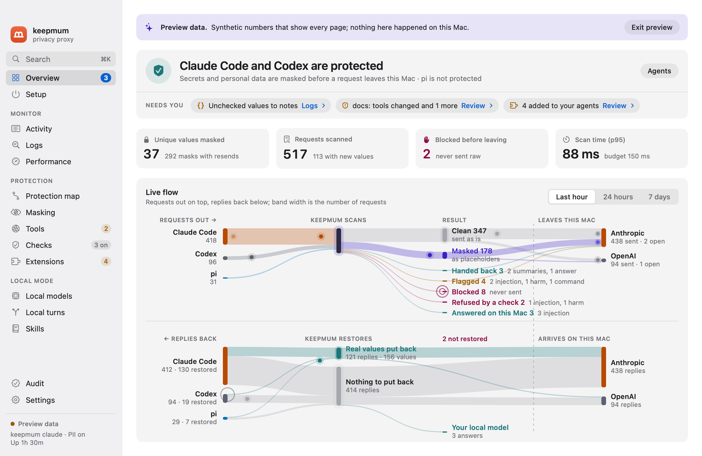

A menu-bar app that sets keepmum up and runs it in the background, with a dashboard: live flow diagrams of requests going out and replies coming back, per coding agent and provider, with hover highlighting; what was found and masked per type, with switches for what gets masked and an editor for your own rules; scan latency; every request in a history; a searchable Logs page of what the checks flagged and what was masked, together in one table or split into two; an Audit page that checks the [audit log](/docs/watch/audit/) and lists every change that turned protection down, and [Extensions](/docs/watch/extensions/), which shows what other apps added to your coding agents and takes it out, in light and dark mode.

Its local stats feed carries counts, types and rules, and for the Logs page only the first and last character of each value of 8 or more characters (`g…w`) and the text around each value with every masked value in it shown as its type, so it cannot show a whole secret even by mistake.

▶ [Take the 58-second tour of the app](https://keepmum.app/#tour): the menu bar, the live Overview, Logs, the Protection map and a turn under review, rendered from the app's own views on preview data.

See [mac/README.md](https://github.com/blueandhack/keepmum/blob/main/mac/README.md) to build it.
