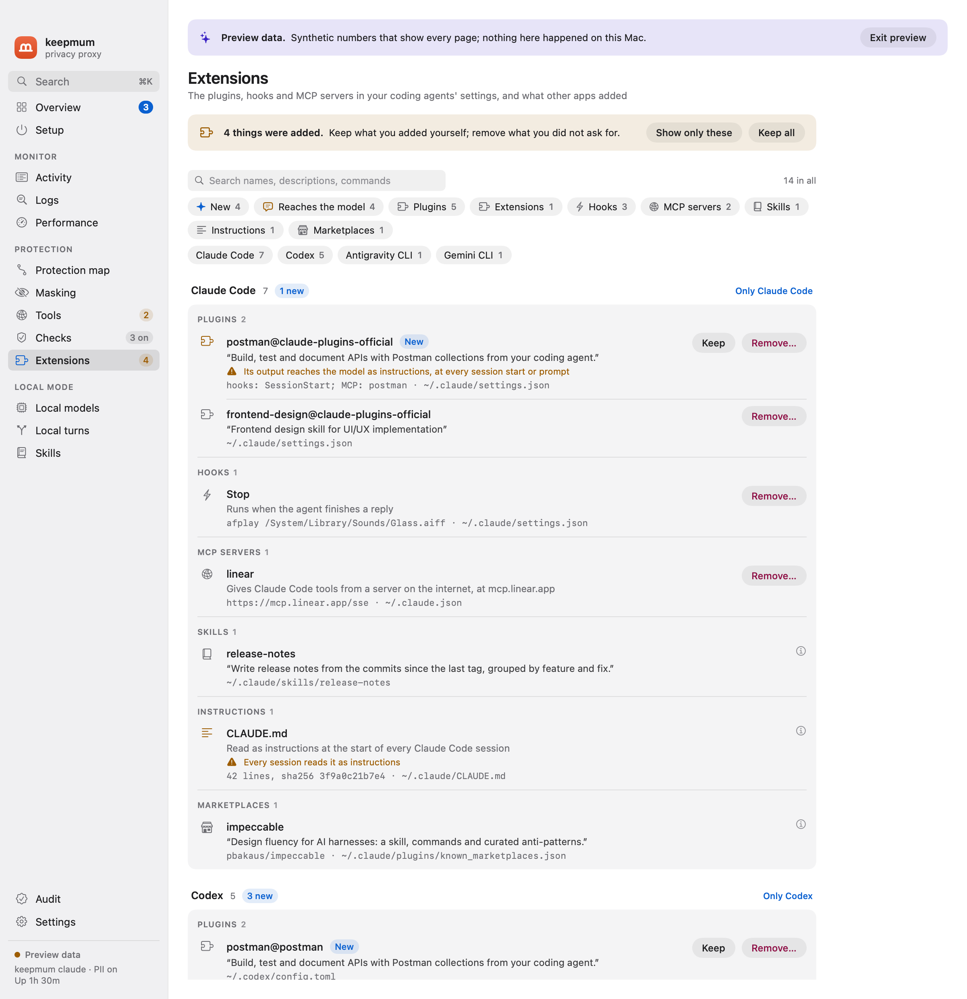

Any app you run can write to your agents' settings. In October 2026 an update to the Postman desktop app enabled its own plugins in Claude Code and Codex, added a hook that told every Codex session to load its skill, marked that hook as trusted on the user's behalf, and connected a remote MCP server, without asking ([postman-app-support#14370](https://github.com/postmanlabs/postman-app-support/issues/14370)). keepmum cannot stop an app from writing those files, so it watches them.



```sh
keepmum extensions              # what each agent has; what is new since you last looked is marked
keepmum extensions keep         # you added them: they are yours now (or name ids to keep some)
keepmum extensions remove <id>  # you did not: take that one entry out, after a backup
```

## What it reads

Plugins, plugin marketplaces, hooks (and the status-line command), Codex's trusted-hook records, MCP servers, skills, and the global instruction file every session reads, in:

- **Claude Code:** `~/.claude/settings.json`, `~/.claude.json`, `~/.claude/skills`, `~/.claude/CLAUDE.md`
- **Codex:** `~/.codex/config.toml`, `~/.codex/skills`, `~/.codex/AGENTS.md`
- **Cursor:** `~/.cursor/mcp.json`, `hooks.json`
- **Gemini CLI:** `~/.gemini/settings.json`, `extensions/`, `GEMINI.md`
- **The Antigravity CLI:** `~/.gemini/config/mcp_config.json`, `hooks.json`, `plugins/` with each plugin's hooks, MCP servers, rules and skills, the global `AGENTS.md`, `GEMINI.md` and `config/rules/`, and `~/.gemini/skills`
- **Copilot CLI:** `~/.copilot/mcp-config.json`
- **opencode**

## What counts as new

The first time keepmum runs, whatever the agents have is yours. The same goes for an agent keepmum starts reading after an update: what the Antigravity CLI already had when keepmum began reading it is yours. After that, anything that appears is new until you keep it or remove it, and an instruction file whose text changed is new again (keepmum keeps a hash of it, never the text).

## What it points out

An item that can put instructions in front of the model by itself: a hook that runs at every session start or prompt, a plugin that brings one, a Codex hook trusted without you being asked, and the global instruction files.

## Where it tells you

The Mac app's menu bar and Extensions, `keepmum doctor`, and one line when `keepmum claude`, `codex`, `gemini` or `agy` starts.

## How it removes

Only the entry you choose, after a copy of the file in `~/.config/keepmum/backups/`, and only if the file reads the same otherwise (a Claude Code plugin is disabled, as `/plugin disable` leaves it). Each removal and each keep is in the [audit log](/docs/watch/audit/). It does not edit opencode's commented JSON, Gemini extension folders, Antigravity plugins, skills, instruction files or Claude Code's own marketplace registry; for those it says how to remove them with the agent. Restart the agent afterwards.

keepmum itself changes an agent's settings only when you turn on its protection, and only the one setting that points it at keepmum.
