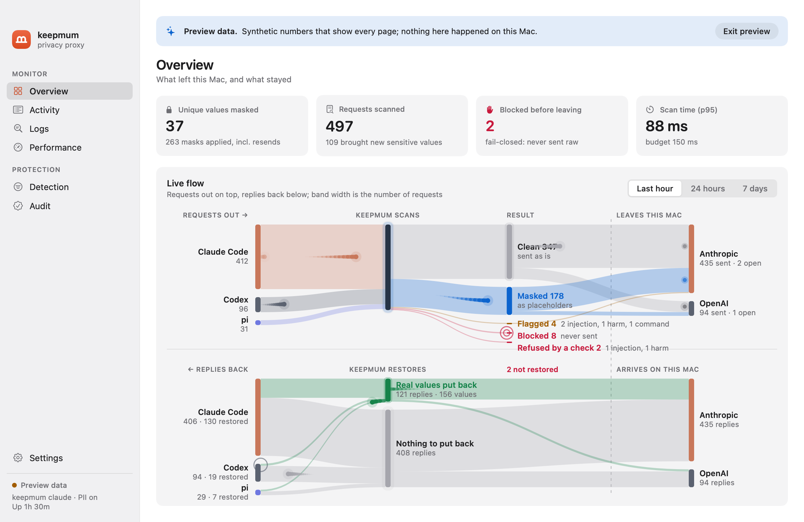
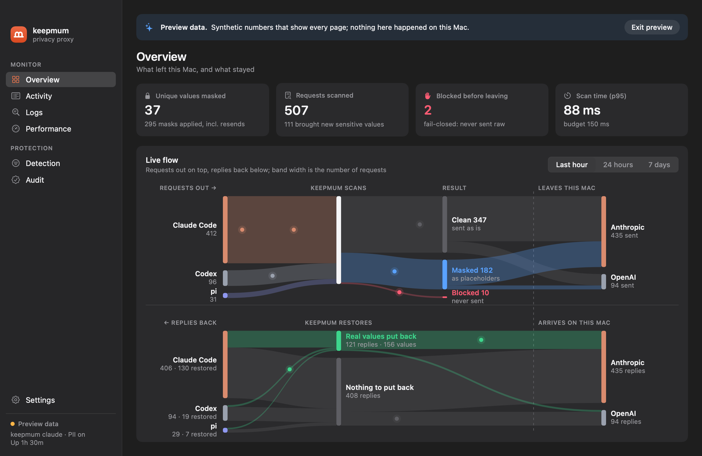
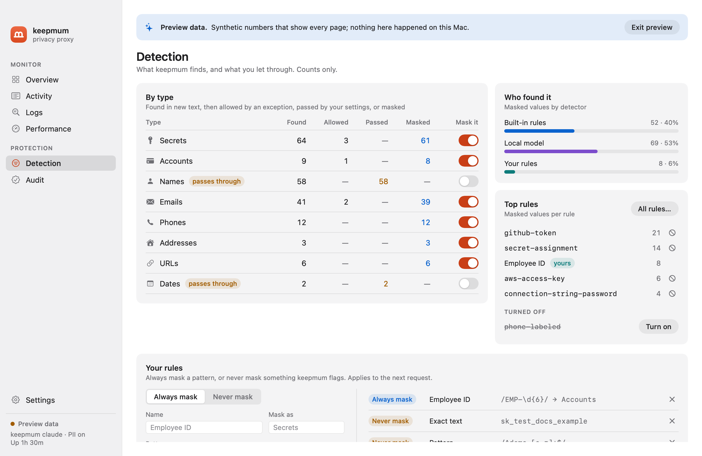
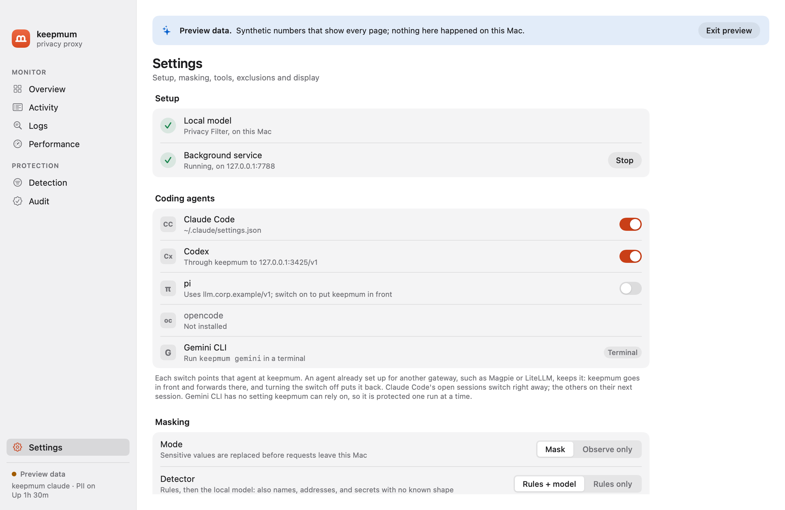
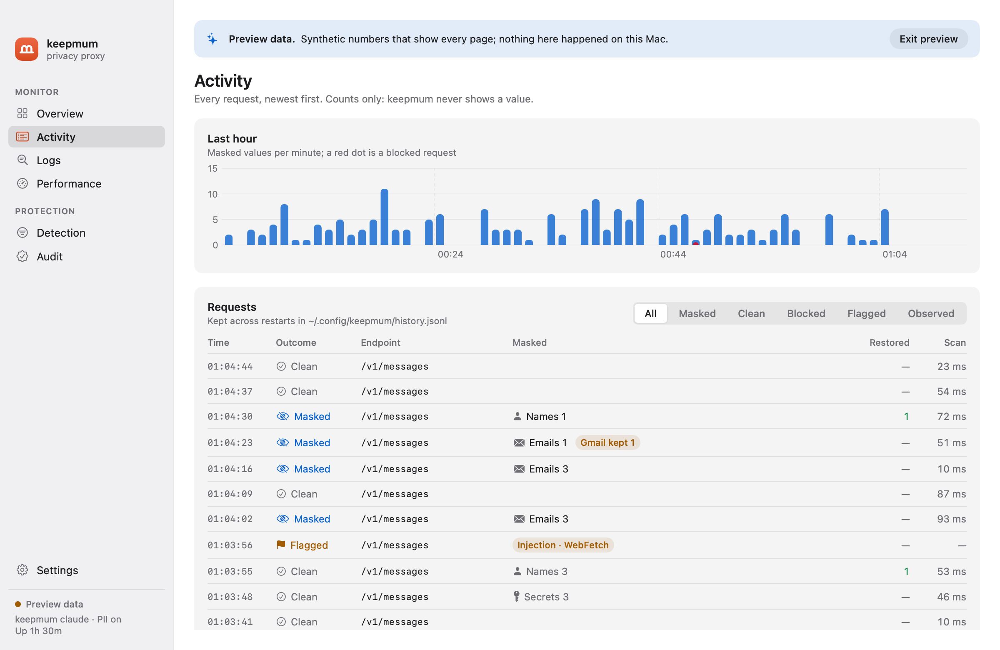

<p align="center"></p>

# keepmum for Mac

A menu-bar app that sets keepmum up, runs it in the background and shows what it does, in light and dark mode. The logo is a sealed m: the m of "mum" standing on a line that closes it, like a shut mouth. keepmum keeps mum about your secrets.

- **Overview:** key numbers and the live flow: two flow diagrams on shared columns, requests going out (client → keepmum's scan → clean, masked, observed or blocked → provider) and replies coming back (provider → keepmum's restore → client). Band width is the number of requests over the last hour, 24 hours or 7 days, and each live request travels its route as a dot. Each coding agent (Claude Code, Codex, Gemini CLI, pi, opencode) gets its own band, told apart by its User-Agent or the header `keepmum protect` adds. Hovering a band highlights it; hovering an agent or provider highlights its whole route in both diagrams.
- **Activity:** every request, newest first, kept across restarts in `~/.config/keepmum/history.jsonl`: outcome (masked, clean, blocked, flagged, observed), what was masked and restored, what an optional check flagged (**Injection · WebFetch**, **Harm · Jailbreak**: crimson when it refused the request, amber when it was sent with a warning), and scan time, filterable by outcome (**Flagged** shows both), with older pages on demand; plus a per-minute chart.
- **Audit:** whether the audit log is intact (`keepmum audit verify`, checked against the head the app saved at its last good check, so a rewrite of the whole log in between shows too), the head to copy and keep elsewhere, and every settings change, protection change, exclusion, start and stop, newest first, with the ones that turned protection down marked and who made them; how long entries are kept (`keepmum audit keep`; a shorter time asks first), and an export as JSONL, which `keepmum audit verify --file` checks, or CSV. Settings changed from the app are recorded as made from Keepmum.app.
- **Logs:** every value masked in new text, newest first, searchable and filterable by type: the agent, the type, the value's shape (`g**********w`, one star per hidden character; values shorter than 8 characters show only stars), the length, and who found it: each built-in rule by name, **Model** when the local model found it too (or alone), **Yours** for your own rules, and **Earlier** for a value masked earlier in the conversation, with who found it then; a menu filters by any of these. Click a row for its details and its context: the text around it as the provider received it, with every masked value shown as its type (`‹SECRET›`). Kept in keepmum's memory only: the list starts empty when keepmum starts. Above it, while a check is on, **Checks** lists what the optional checks flagged: the agent, the check, where (a tool's result, or what was typed, with the harm model's categories), the score, the length and what happened: refused, answered by a local model, a command replaced, or sent with a warning; never the text. Click one for its details: the check's mode, model and threshold, where the request was going, which local model answered (and any passed over), and what to do next.
- **Detection:** per type, how many values were found, allowed by an exception, passed through by your settings, and masked, with a switch to stop masking a type (names, dates…; secrets ask first); which detector found them (built-in rules, the local model, your rules) and the top rules, each built-in one with a button to turn it off, and **All rules…** for every built-in rule with a switch each (`keepmum rules builtin`); and your own rules: patterns always masked and exceptions never masked.
- **Performance:** scan time against the 150 ms budget, and its distribution.
- **Settings,** one pane at a time, with a list of panes beside it that shows what needs a look (setup not finished, tools to review, how many checks are on, an update). On a wide window, a pane with two groups of sections puts them side by side.
  - **Setup:** download the model, start the background service, and one protection switch per coding agent.
  - **Masking:** mode (mask, or observe only), detector (the rules and the local model, or the rules alone: `keepmum model`), personal data (names, emails, phones and addresses too: `keepmum pii`), and excluded projects (`keepmum exclude`).
  - **Tools:** each MCP server and web tool agents offered, and what it may receive: placeholders only, the values it gave you, or also contact details. A server whose tools changed is paused until you trust it again, and calls this week that kept placeholders a setting would let through get a suggestion (`keepmum tools`). Shell commands: hosts a shell command may send a rule's tokens to, besides its issuer's, such as a company GitLab; adding one asks first (`keepmum destinations`).
  - **Checks:** the optional prompt-injection, harm and risky-commands checks: download, Off, Warn or Block each (injection and harm also Local: a flagged request is answered by a model on your Mac instead of being sent), the harm model (Small, Qwen3Guard 0.6B or 4B), and beside them **Local servers**: Ollama, LM Studio, llama.cpp, MLX or another server on this Mac, in the order tried, each with its model, chosen from what it has, and the checks it answers for (`keepmum guard`, `keepmum guard local`).
  - **General:** display (appearance, Dock, preview data), updates (check now, check automatically once a day, download and install automatically), the Logs page (value previews and the text around values: `keepmum log`), and connection details.
  - **Check this Mac:** `keepmum doctor`.
- **Menu bar:** the key numbers, which agents are protected, and a shortcut to the dashboard. A dot on the icon and a line in the panel point at a new tool server, at one whose tools changed, or at an agent that skips keepmum because another gateway's app pointed it back at that gateway (**Protect** fixes it). Activity marks tool calls that kept placeholders, with why.







**Privacy.** The app reads keepmum's local feeds (`/_keepmum/stats`, `/_keepmum/flows`, `/_keepmum/history`, `/_keepmum/findings`, `/_keepmum/tools`), which carry counts, types, tool names and timestamps, never a placeholder or a whole value. The Logs feed (`/_keepmum/findings`) also carries the first and last character of each masked value of 8 or more characters, and up to 80 characters of text on each side of it with every masked value and placeholder shown as its type; it lives in keepmum's memory only, and `[log] previews = false` and `[log] context = false` in keepmum's config turn those off and forget what was kept. It finds the proxy through `~/.config/keepmum/runtime.json` (written by `keepmum claude` and `keepmum serve`; port 7788 otherwise). It authenticates with the token in `~/.config/keepmum/stats-token` (mode 0600). It talks only to 127.0.0.1 and sends no telemetry. The one exception is update checks (Settings › General › Updates), which keepmum asks about on the first launch and does only if you say yes: each one downloads the update feed from github.com, so GitHub sees your IP address and keepmum's version, and nothing else is sent.

```sh
./build-app.sh                  # build/Keepmum.app with the engine, signed with your Apple Development identity (or ad-hoc)
SKIP_RUNTIME=1 ./build-app.sh   # the dashboard alone, for UI work
SWIFT_CONFIG=debug ./build-app.sh  # unoptimized dashboard, ~1 s to rebuild after an edit
open build/Keepmum.app
```

**What the app bundles** (`bundle-runtime.sh`): a relocatable CPython 3.12 with keepmum and its locked dependencies (without rich, which only draws boxed help), pf-serve and llama-server (the optional checks' runtime) built from pinned sources, the `keepmum` command the app runs for setup and protection, and a LaunchAgent (`Contents/Library/LaunchAgents/app.keepmum.agent.plist`) that runs `keepmum serve` at login, registered with SMAppService. The bundled Python runs isolated (`-I`) and never writes into the signed bundle (`-B`; everything is compiled at build time). The model (1.6 GB) is downloaded on first use into `~/.local/share/keepmum`, which the command line shares; the optional checks' models only when you set one up. The app and the command line share one placeholder key, `~/.config/keepmum/salt` (0600), so a placeholder made by either is restored by the other.

**Setup**, in Settings, takes three steps, each also available on the command line: download the model (`keepmum setup`; not needed with Detector set to rules only), start the background service (macOS may ask you to allow it in System Settings › Login Items), and, under **Coding agents**, one switch each for Claude Code, Codex, pi and opencode (`keepmum protect on --client …`). An agent already set up for another gateway (Magpie, LiteLLM) keeps it. Its switch puts keepmum in front, so the row reads "Through keepmum to 127.0.0.1:3425", and turning the switch off puts the gateway back. Gemini CLI has no switch: it is protected one run at a time with `keepmum gemini`, since any project's `.env` file would override a setting. A switch turns on only while the service runs, and stopping the service turns protection off for every agent first, so no agent is pointed at a proxy that is not there.

- **Observe only** (Settings › Masking) asks before it turns masking off, and while it is on every page opens with a red banner and a **Mask again** button.
- **Preview data** (Settings › General › Display) shows animated sample data on every page, under a banner that says so.
- `Keepmum --snapshot dir` renders every page in light and dark to PNGs and exits, with the Settings page in full and the overview in observe mode; with `--live` it renders the overview from the running proxy.
- **Design.** Every color, text style, space and radius comes from the tokens in `Sources/Keepmum/Tokens.swift`; the controls built on them are in `Components.swift`. Coral, keepmum's own, marks what is selected or pressable; blue is masked, green restored, crimson blocked, amber let through.
- Development-signed builds run only on this Mac. For other Macs, see Releasing.

## Releasing

A release is a notarized `Keepmum-<version>.dmg` on the repository's GitHub Releases page. Apple's notarization is what lets the app open on other Macs without a warning; it needs a paid Apple Developer membership.

**Once per Mac:**

1. **Developer ID certificate.** Xcode › Settings › Accounts › your team › Manage Certificates › **+** › *Developer ID Application* (only the account holder can create one). Check: `security find-identity -v -p codesigning` lists `Developer ID Application: …`.
2. **Notary credentials**, kept in the Keychain. Create an app-specific password at account.apple.com › Sign-In and Security, then:
   ```sh
   xcrun notarytool store-credentials keepmum-notary --apple-id you@example.com --team-id ABCDE12345
   ```
   It asks for the password and checks it with Apple.
3. **Update signing key** (Sparkle, EdDSA), kept in the login Keychain. Installed apps accept an update only if it is signed with it, so back it up: losing it means existing installs can no longer update on their own.
   ```sh
   SPARKLE=$(mac/sparkle-tools.sh)               # Sparkle's tools, pinned, into mac/.sparkle
   "$SPARKLE/generate_keys"                      # makes the key once; prints its public half
   "$SPARKLE/generate_keys" -p > mac/sparkle-public-key && git add mac/sparkle-public-key
   "$SPARKLE/generate_keys" -x sparkle-private-key  # a backup to keep somewhere safe, then delete this file
   ```
   Builds with `mac/sparkle-public-key` have an updater; builds without it (or with `SPARKLE_PUBLIC_KEY` empty) have none.

**Each release:**

```sh
# 1. set the version in pyproject.toml and src/keepmum/__init__.py, run `uv lock`, commit
RELEASE_NOTES=notes.md mac/release.sh          # tests, build, sign, notarize, staple -> dist/; adds it to mac/appcast.xml and site/index.html
git push origin main
git tag -s v0.1.0a2 -m "keepmum 0.1.0 alpha 2" && git push origin v0.1.0a2
gh release create v0.1.0a2 dist/Keepmum-0.1.0a2.dmg dist/Keepmum-0.1.0a2.dmg.sha256 \
  --verify-tag --prerelease --title "keepmum 0.1.0 alpha 2" --notes-file notes.md
git commit -m "chore: keepmum 0.1.0a2 in the update feed" mac/appcast.xml site/index.html && git push origin main   # installed apps and keepmum.app see it now
```

Versions follow PEP 440: alphas are `0.1.0a1`, `0.1.0a2`…, then `0.1.0`. The tag and the DMG carry the full version. Apple's version fields in the app take numbers and dots only, so `build-app.sh` writes `0.1.0` as `CFBundleShortVersionString`, the full version as `KeepmumVersion`, and as `CFBundleVersion` a build number that rises in PEP 440 order, which is what the updater compares: `0.1.0a1` is 10001, `0.1.0a2` 10002, `0.1.0b1` 10031, `0.1.0rc1` 10061, `0.1.0` 10099. The first release, 0.1.0a1, came out on Nov 3, 2026.

**Updates.** The app updates itself with [Sparkle](https://sparkle-project.org) 2.10.1 (`Updater.swift`). It reads `mac/appcast.xml` on GitHub (`raw.githubusercontent.com/blueandhack/keepmum/main/mac/appcast.xml`), which lists each release's DMG on GitHub Releases. Two signatures protect it: the feed's own, without which the app ignores the feed (`SURequireSignedFeed`), and each DMG's, checked before it is unpacked (`SUVerifyUpdateBeforeExtraction`), on top of Apple's notarization and the Developer ID signature. `release.sh` signs both with the key above, through `appcast.py` and Sparkle's `sign_update`. The feed goes on `main` only after the GitHub release exists, since it points at the release's DMG. Sparkle's XPC services, which only sandboxed apps need, are left out of the app. After an update, the app re-registers the background service, so launchd runs the new engine.

**The DMG.** `make-dmg.sh` lays it out: the app and a link to Applications on a background that says to drag one onto the other (`Keepmum --dmg-background`, drawn by the app like its icon, at 1x and 2x), and the app's icon as the mounted volume's. It uses [dmgbuild](https://github.com/dmgbuild/dmgbuild) (the `release` dependency group, pinned in `uv.lock`), which writes Finder's window settings itself, so a release needs no Finder scripting and runs unattended. Finder adds the bars the user's own Finder shows (tab, path, status) whatever the DMG asks, so the window is taller than what matters on the background. `mac/make-dmg.sh <app> <dmg> <volume name>` makes one to look at.

`release.sh` refuses an uncommitted tree, notarizes the app and then the DMG, staples both tickets (so the app opens offline after it is copied out), and ends by asking Gatekeeper (`spctl`) for the verdict another Mac would reach. A rejected submission prints Apple's log. `SKIP_NOTARIZE=1 ALLOW_DIRTY=1 mac/release.sh` runs every other step with your development identity, to test it.

Users download the DMG, drag Keepmum into Applications, open it, and follow Settings › Setup. Drop `--prerelease` from the first version without a letter (`0.1.0`). After publishing, download the release into an empty folder and check it as a user would: `shasum -a 256 -c Keepmum-<version>.dmg.sha256`, `spctl --assess --type open --context context:primary-signature -v Keepmum-<version>.dmg`, `xcrun stapler validate Keepmum-<version>.dmg`. Release builds happen on a Mac you control rather than in CI, so the signing certificate never leaves it.

**Logos.** Claude Code and the Anthropic API appear with their official logos (`Brand/`, from Anthropic's [press kit](https://www.anthropic.com/press-kit), used unmodified to identify those services; see [Brand/NOTICE.md](Brand/NOTICE.md)). Claude, Claude Code and Anthropic are trademarks of Anthropic, PBC; keepmum is an independent project, not affiliated with or endorsed by Anthropic. "This Mac" shows a laptop or a Mac mini, depending on whether the Mac has a battery.

Requires macOS 14 or later.
